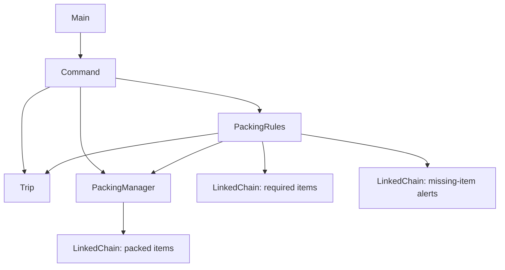

# Suitcase Check

This project is Suitcase Check. It is a command line program that helps college students like us plan for a trip without missing important items. The user enters the destination and number of days, packs items, and uses the check command to see whether anything required is missing.

## Commands

- `trip <destination> <days>` starts a trip with a destination and a number of days from 1–30.
- `pack <item>` adds one copy of an item to the suitcase.
- `unpack <item>` removes one copy of an item from the suitcase.
- `list` lists the items inside.
- `check` prints "All set." or alerts for missing required items.
- `template beach` adds sunscreen, a swimsuit, and a towel.
- `template business` adds a laptop, a notebook, and a formal shirt.
- `quit` exits the program.

Templates only add items that are not already packed. Applying the same template twice does not add duplicates. Templates do not change the required-item rules.

Some items are always required: a passport, charger, toothbrush, and one tshirt per day. Our fixed umbrella rule applies to Seattle, London, Vancouver, Portland, Dublin, Glasgow, Amsterdam, Singapore, and Hong Kong. This rule uses a city list, not live weather data.

Item names are case insensitive and must contain 1–30 characters using letters, spaces, and hyphens. A new trip replaces the previous trip but keeps the packed items.

### Example

Enter one command at a time:

```text
trip London 2
pack passport
pack charger
pack toothbrush
pack tshirt
pack tshirt
pack umbrella
check
template beach
list
quit
```

The check command in this example prints "All set."

## Compile and Run

Use JDK 17. The project includes `lib/student.jar`, which is needed to compile and run the tests.

### How to compile and run the program

Open a terminal in the project folder, where `src`, `test`, and `lib` are located.

If the `bin` folder does not already exist, create it:

```text
mkdir bin
```

Compile the source files and tests, then start the program:

```text
javac -cp lib/student.jar -d bin src/*.java test/*.java
java -cp bin Main
```

### How to run the JUnit tests

After compiling, run this on Windows:

```text
java -cp "bin;lib/student.jar" org.junit.runner.JUnitCore AlertTest CommandTest ItemTest LinkedChainTest MainTest PackingManagerTest PackingRulesTest TripTest
```

On macOS or Linux, use a colon in the classpath:

```text
java -cp "bin:lib/student.jar" org.junit.runner.JUnitCore AlertTest CommandTest ItemTest LinkedChainTest MainTest PackingManagerTest PackingRulesTest TripTest
```

In Eclipse, right-click `Main.java` and choose **Run As > Java Application** to run the program. Right-click the `test` folder and choose **Run As > JUnit Test** to run the tests.

The current build was compiled and tested on Java 17. All 50 tests passed.

## System Diagram



`Main` reads input and handles `quit`. `Command` processes the other commands, including packing templates. `Trip` stores the destination and days. `PackingManager` stores packed items, and `PackingRules` builds the required list and checks for missing items.

The same generic `LinkedChain<T>` class is reused for both `Item` and `Alert` objects. The application classes access the chain through its public methods.

## Reflection

### What changed from the specification, and why?

The main design pretty much stayed the same, with `Main` starting the program and `Command` handling input, while `Trip`, `PackingManager`, and `PackingRules` do the work of the program.

- **Command methods.** The spec had separate methods for commands (`startTrip`, `packing`, `unpacking`, and so on). To make it simpler, we wrote one `processCommand` method that checks which command was typed, since the commands share input parsing.
- **PackingManager.** We added `countItem` and `getItemCount`. `check()` has to know how many copies of the same item are in the suitcase, and the tests need to check the suitcase without reading the list text.
- **PackingRules.** The spec left `check(...)` vague. It is now `check(Trip, PackingManager)` and returns a `LinkedChain<Alert>`. `getRequired(Trip)` returns a `LinkedChain<Item>`.
- **Where validation lives.** The spec said invalid input would re-prompt inside the constructors. We changed it so that `Trip`, `Item`, and `Alert` throw an `IllegalArgumentException`, and `Command` prints the exception message. The user can then type the next command. This makes validation easier to test.
- **Item names.** Checking the item name moved from `PackingManager.packItem()` into the `Item` constructor. Names must contain 1–30 characters using letters, spaces, and hyphens. Numbers and apostrophes are not supported.
- **Days.** The spec table only mentioned negative numbers and zero. We used the scope's range of 1–30. Invalid days print "Days must be 1 to 30."
- **Tests.** We added test files for `Item`, `Alert`, `Trip`, and `Main`, since validation and input handling are covered by those classes. Where the test plan said `packItem("")` should leave the suitcase alone, the test now expects an exception and checks that the count stays the same.
- **Constants and cities.** Required basic items and umbrella cities are stored in named constants. The umbrella list was expanded from three cities to nine.
- **Templates.** We added simple beach and business templates. Each template adds missing items without duplicating items already in the suitcase.

Smaller things we decided while coding: a new `trip` replaces the old one but keeps the suitcase, item names are not case sensitive, and `quit` is handled in `Main`. Also, `list` prints the newest item first because `LinkedChain.add()` puts new entries at the front.

### What changed in LinkedChain, and why?

Nothing, we used it as given. We only call the public methods: `add`, `remove`, `contains`, `count`, `size`, `isEmpty`, and `toArray`. The same generic class holds `Item` objects in the suitcase and required list, and `Alert` objects for check results, so separate chain implementations are not necessary. For `remove` and `count` to work on items, we wrote `equals` and `hashCode` in `Item`.

Big-O of our methods compared to the spec:

Let n be the number of packed items. Item names are limited to 30 characters.

- `packItem` is O(1), same as the spec.
- `unpackItem` is O(n), same as the spec.
- `list` and `countItem` are O(n).
- `PackingRules.check` is O(n) for the current rules. The required list has at most 34 entries: three basics, up to 30 tshirts, and one umbrella. It scans the packed chain for a fixed number of distinct required items. Our earlier O(n²) estimate treated the required list as growing without a fixed limit.
- Applying a template is O(n), since each template checks three items against the packed chain.
- `processCommand` depends on the command. Commands such as `list`, `unpack`, `check`, and `template` are O(n), so its worst-case complexity with the current rules is O(n).

The 1–30 day limit bounds the required list, but it does not limit how many items the user can pack.

### Which unknowns were resolved, and which remain open?

- **How to make a generic LinkedChain work with multiple object types.** One `LinkedChain<T>` implementation is used for `Item` and `Alert`. Item matching depends on `equals`.
- **How to make packing recommendations.** We used a small fixed set of rules: basics, a tshirt per day, and an umbrella for nine cities. Named constants make the basic items and cities easier to change. Live weather recommendations remain outside the project.
- **Odd item names.** We chose a 30-character limit and allow letters, spaces, and hyphens. Numbers and apostrophes remain unsupported.
- **How templates should handle duplicates.** Templates add one copy only when the item is not already packed. Applying a template again leaves existing items unchanged.

### What does not work yet?

- Saving and reloading trips are not implemented. Packed items and trip information are lost when the program exits.
- There is no live weather API. Umbrella recommendations use a fixed list of nine cities.
- Item names with numbers or apostrophes are rejected.
- Only beach and business templates are available. Users cannot create custom templates.
- Templates add items but do not change what `check` considers required.

`quit` is intentionally handled by `Main`. Invalid input prints an error and lets the user enter another command; the program does not stop or repeatedly prompt for the same field.

## Next Steps

### What is left to finish the MVP, and in what order?

The implemented MVP compiles and runs on Java 17, and all 50 tests pass. The umbrella city list and basic items use named constants, and the beach and business templates are implemented.

The remaining final checks are:

1. Review comments and confirm that the README matches the submitted code.
2. Review test coverage against the required normal and bad-input cases for public methods.
3. Confirm that the final code, tests, README, and system diagram are in the public GitHub repository.
4. Prepare the presentation and live demo.

### Which stretch goals were completed or dropped?

- **Expanded umbrella city list: completed.** Nine configured cities require an umbrella. Other destinations do not receive this requirement.
- **Reusable packing templates: completed.** Beach and business templates add preset items without duplicating items already packed.
- **Saving and reloading trips: dropped.** The project focuses on the chain rather than file storage.
- **Weather API: dropped.** It adds network code that does not test the chain and was outside our time limit.

### What new tests were added, and what could be added later?

Added tests cover:

- All nine umbrella cities, case-insensitive city matching, and a destination outside the list.
- Beach and business templates adding the correct items.
- Applying the same template twice without adding duplicates.
- Preserving existing packed items when applying a template.
- Rejecting missing or unknown template names without changing the suitcase.
- Adding a template item again after it has been unpacked.

Existing command tests also cover command capitalization, extra spaces, duplicate packing, invalid input, and retaining packed items when changing trips.

Future tests could cover a much larger suitcase with many duplicates and changing to a different valid trip between two `check` commands.

### Who does what?

| Remaining task | Team member |
| --- | --- |
| Run tests on Java 17 and fix failures | Nie |
| Item name rules and `ItemTest` | Bagu |
| `PackingRules.check` cleanup and tests | Luc |
| Move `quit` into `Command`, update `CommandTest` and `MainTest` | Bagu |
| Constants for required items | Shresta |
| Packing templates and their tests | Shresta, Nie |
| Comments and final README | Luc |

This table retains the original task assignments. The final design keeps `quit` in `Main`, so the planned move into `Command` was not carried out.

## Work Attribution

| Class or test file | Team member(s) | Contribution |
| --- | --- | --- |
| Main.java | Nie | Reads input in a loop and handles `quit` |
| Command.java | Bagu | Parses commands and prints error messages |
| Trip.java | Luc | Stores destination and days, validates them |
| PackingRules.java | Nie | Required items and `check()` |
| PackingManager.java | Nie | Pack, unpack, and list using `LinkedChain<Item>` |
| Item.java | Bagu | Item name, validation, `equals` and `hashCode` |
| Alert.java | Bagu | Holds one "Missing: ..." message |
| LinkedChain.java | CS 2114 Staff | Provided, we did not change it |
| MainTest.java | Bagu | Runs `Main` with fake input |
| CommandTest.java | Luc | Tests commands and bad input |
| TripTest.java | Nie | Tests valid and invalid trips |
| PackingRulesTest.java | Shresta | Tests required items and `check()` |
| PackingManagerTest.java | Luc | Tests pack, unpack, list, count |
| ItemTest.java | Shresta | Tests names and equality |
| AlertTest.java | Shresta | Tests messages |
| LinkedChainTest.java | Shresta | Tests the chain, including using it for `Alert` |

## GenAI Use Note

We used GenAI to help format the test plan and figure out what test cases we needed. We also used it to give guidance on the project when we stuck on debugging, on some logic errors, and when we could not figure out why our program was not working properly 

GenAI was used on the source and test files to help with logical errors and debugging problems
